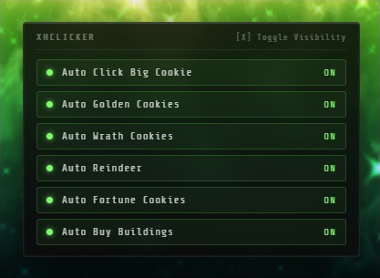

# xhClicker

A lightweight autoclicker mod for Cookie Clicker, with a clean floating UI panel to toggle each feature on or off.



## Steam Workshop stats

<!-- STATS:START -->


<!-- STATS:END -->

## Features

- **Auto Click Big Cookie** - automatically clicks the big cookie
- **Auto Golden Cookies** - automatically clicks golden cookie shimmers
- **Auto Wrath Cookies** - automatically clicks wrath cookie shimmers
- **Auto Reindeer** - automatically clicks reindeer during Christmas events
- **Auto Fortune Cookies** - automatically clicks the fortune ticker effect
- **Auto Buy Buildings** - automatically buys any building you can afford, usually used to quickly get the progress back after ascension

Press `X` to show/hide the control panel.

## Installation

### Browser (Steam or web version of Cookie Clicker)

You have a few options for running the mod in-browser:

The script is hosted on GitHub, so you don't need to copy/paste the full file - just fetch and run it directly from the raw URL:

```
https://raw.githubusercontent.com/xhvsh/xhclicker/refs/heads/main/main.js
```

**Option 1 - Browser console (quick, one-time use)**
1. Open Cookie Clicker and let the game fully load.
2. Open your browser's developer console (`F12` or `Ctrl+Shift+J` / `Cmd+Option+J`).
3. Paste this single line and press Enter:
   ```javascript
   fetch('https://raw.githubusercontent.com/xhvsh/xhclicker/refs/heads/main/main.js').then(r=>r.text()).then(eval);
   ```
4. The mod loads immediately. Note: you'll need to repeat this every time you reload the page.

**Option 2 - Tampermonkey (recommended for persistent use)**
1. Install the [Tampermonkey](https://www.tampermonkey.net/) extension for your browser.
2. Create a new script in Tampermonkey and replace its contents with:
   ```javascript
   // ==UserScript==
   // @name         xhClicker
   // @match        https://orteil.dashnet.org/cookieclicker/*
   // @match        https://steamcommunity.com/app/1454400*
   // @require      https://raw.githubusercontent.com/xhvsh/xhclicker/refs/heads/main/main.js
   // @grant        none
   // ==/UserScript==
   ```
3. Save the script. `@require` pulls the latest version straight from GitHub every time you load Cookie Clicker — no manual updates needed.

**Option 3 - Bookmarklet**
1. Create a new browser bookmark.
2. Set the bookmark's URL to:
   ```
   javascript:(function(){fetch('https://raw.githubusercontent.com/xhvsh/xhclicker/refs/heads/main/main.js').then(r=>r.text()).then(eval);})();
   ```
3. With Cookie Clicker open, click the bookmark to load the mod.

### Steam version

The Steam version of Cookie Clicker supports the in-game Steam Workshop mod loader, so you don't need to touch the console at all:

1. Subscribe to the mod on the [Steam Workshop](https://steamcommunity.com/sharedfiles/filedetails/?id=3738413378)
2. Launch Cookie Clicker through Steam.
3. The mod will load automatically - look for the "xhClicker loaded" notification in-game.
4. Press `X` anytime to show/hide the panel.

Thanks for using my mod, if you encounter any issues or have any suggestions either post them here, in steam comments under this mod or contact me directly on discord `xhvsh`
